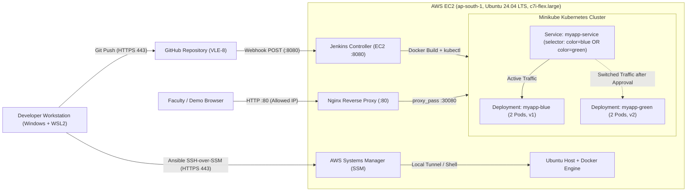
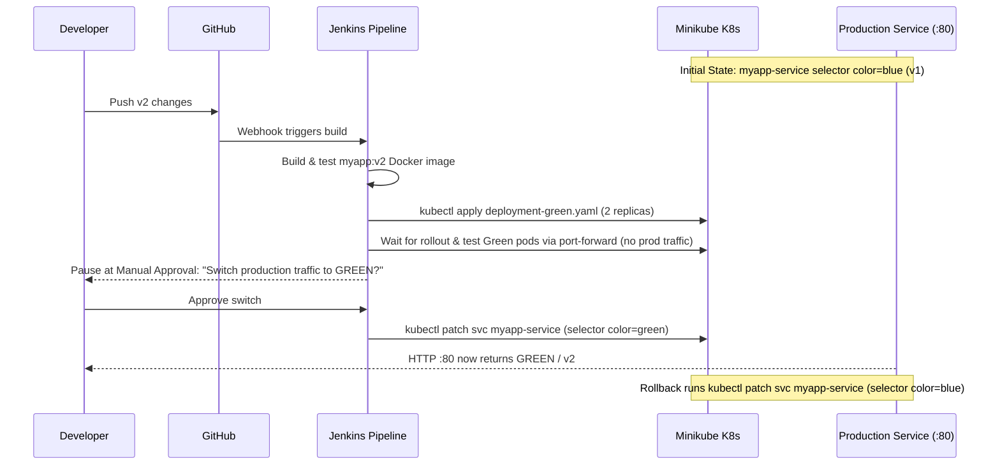

# VLE-8 Architecture & Cost Design — Blue-Green Deployment

## 1. Network & Access Architecture (College Wi-Fi Constraints)

Diagnostic tests from the local Windows 11 + WSL2 workstation on college Wi-Fi revealed:

| Port / Protocol | Target Tested | Status | Architectural Impact |
|---|---|---|---|
| TCP 22 (SSH) | `github.com:22`, `portquiz.net:22` | **Blocked** | Direct SSH to EC2 is blocked; port 22 is kept **closed** in the Security Group. |
| TCP 443 (HTTPS) | `github.com:443`, `ssh.github.com:443`, `ec2.ap-south-1.amazonaws.com:443`, `ssm.ap-south-1.amazonaws.com:443` | **Open** | GitHub HTTPS pushes, AWS API calls, and **AWS SSM Session Manager** (shell + SSH-over-SSM + port forwarding) work cleanly over 443. |
| TCP 80 (HTTP) | `portquiz.net:80` | **Open** | Demo application is exposed on EC2 port 80 via Nginx reverse-proxying to Minikube's `NodePort` (`30080`). |
| TCP 8080 (HTTP Alt) | `portquiz.net:8080` | **Open** | Jenkins UI and GitHub Webhooks work over port 8080, restricted to the user's IP and official GitHub webhook CIDRs. |
| TCP 30080 (NodePort) | `portquiz.net:30080` | **Blocked** | Direct external access to Kubernetes NodePort `30080` is blocked by campus firewall, so Nginx on EC2 `:80` bridges external HTTP traffic to Minikube `:30080`. |

## 2. System & Blue-Green Traffic Architecture

## 3. Blue-Green Switching & Independent Verification Flow

## 4. AWS Sizing & Cost Estimate (`ap-south-1` Mumbai)

Live pricing queried from the AWS Pricing API for `ap-south-1`:

> **Account Constraint Discovered During Provisioning:** The AWS account operates on the AWS Free Plan, which rejects `t3a.medium` (`InvalidParameterCombination: The specified instance type is not eligible for Free Tier`). Among `free-tier-eligible=true` `x86_64` instance types in `ap-south-1`, **`c7i-flex.large`** (2 vCPU, 4 GiB RAM) satisfies the 4 GiB RAM requirement for Minikube + Jenkins + Docker.

| Resource | Specification | Unit Rate (USD) | Hourly Cost | 4-Hour Lab Cost | Monthly (24/7) |
|---|---|---:|---:|---:|---:|
| EC2 Instance | `c7i-flex.large` (2 vCPU, 4 GiB RAM, Free-Tier eligible) | $0.08479 / hr *(On-Demand)* | $0.08479 | $0.339 | ~$61.90 |
| EBS Root Volume | 30 GiB `gp3` (3000 IOPS, 125 MiB/s included) | $0.0912 / GB-mo | ~$0.0037 | ~$0.015 | $2.74 |
| Default VPC / SSM Core / SG | Standard AWS primitives | $0.00 | $0.00 | $0.00 | $0.00 |
| **Total Estimated Cost** | *(if billed On-Demand outside Free-Tier credits)* | — | **~$0.0885 / hr** | **~$0.354** | **~$64.64 / mo** |

### Why `c7i-flex.large` instead of `t2.medium`, `t3a.medium`, or `t3.small`?
- **Vs. `t3a.medium` / `t2.medium`:** Rejected by AWS Free Plan (`free-tier-eligible=true` required by `RunInstances`).
- **Vs. `t3.small` (2 GiB RAM, $0.0224/hr):** Minikube requires ~1.8–2.0 GiB RAM alongside Jenkins JVM (~768 MiB) and Docker builds; 2 GiB total RAM risks OOM kills.
- **Vs. `m7i-flex.large` (8 GiB RAM, $0.10075/hr):** `c7i-flex.large` meets the 4 GiB RAM requirement at lower cost.
- **Avoided expensive resources:** No EKS control plane ($0.10/hr + worker nodes), no NAT Gateway ($0.045/hr+), and no Application/Classic Load Balancer ($0.025/hr+).

